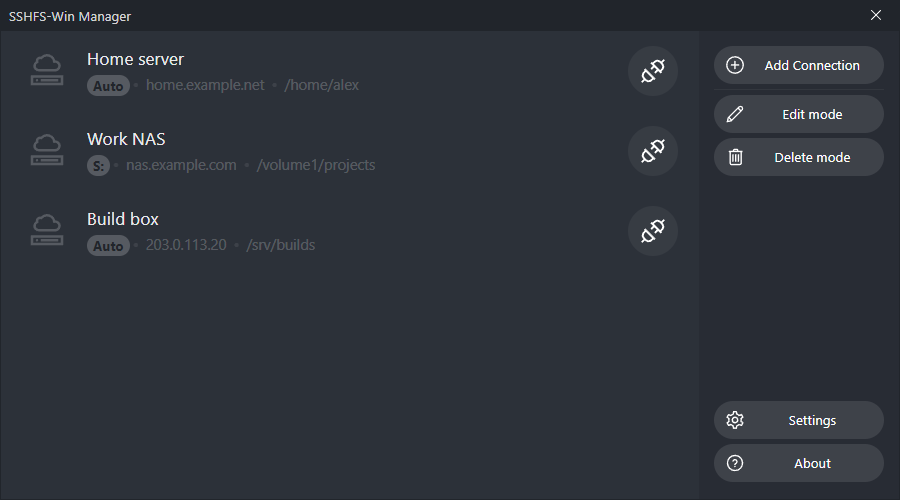
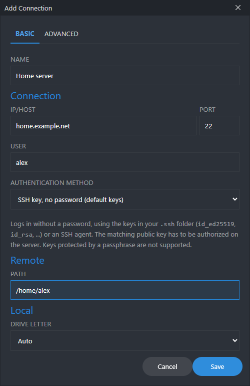
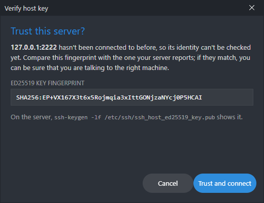
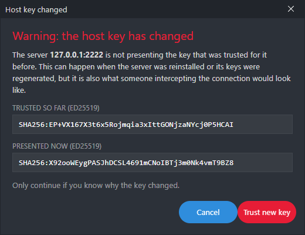
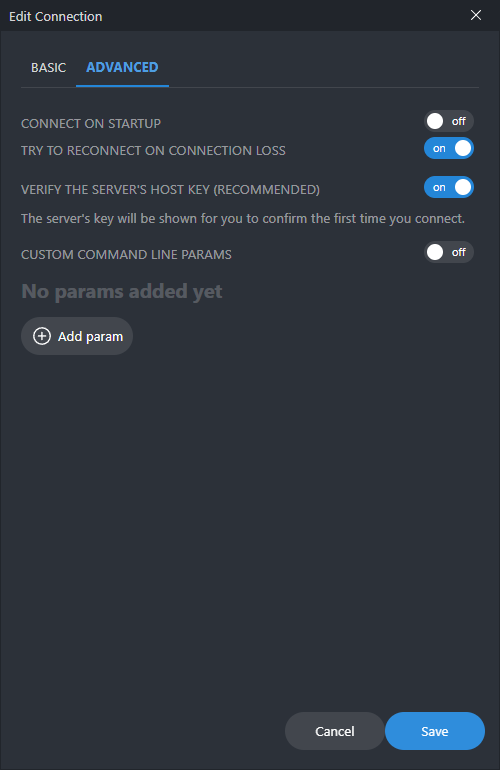

<p align="center">
  
  
  
</p>

# SSHFS-Win Manager

A friendly Windows app for mounting remote folders as drives over SSH, built on [SSHFS-Win](https://github.com/billziss-gh/sshfs-win).
Add your servers once, then connect and disconnect with a click from the window or the system tray.



> This is a fork of [evsar3/sshfs-win-manager](https://github.com/evsar3/sshfs-win-manager). It fixes the connections that hung on
> "connecting", checks the identity of the servers you connect to, supports passwordless key logins, and moves the
> app to current versions of everything. Your saved connections from the original carry over. See [What's different](#whats-different-from-the-original).

## Installation

**Step 1** &ndash; Install [SSHFS-Win](https://github.com/billziss-gh/sshfs-win) (follow its
[installation instructions](https://github.com/billziss-gh/sshfs-win/blob/master/README.md); it brings WinFsp along).

**Step 2** &ndash; [Download the latest sshfs-win-manager](https://github.com/JawshTheDark/sshfs-win-manager/releases/latest) and run the installer.

- If you have the original SSHFS-Win Manager running, **quit it first** (system tray icon, right-click, *Quit*). The new one won't start while another copy is open.
- The installer is **not code-signed**, so Windows SmartScreen may warn about it. Choose *More info*, then *Run anyway*. The release lists a SHA-256 checksum to compare against.

**Step 3** &ndash; Add your connections and enjoy!

Requires Windows 10 or 11 (64-bit).

## Features

- **Several ways to log in**
  - Password (stored encrypted, see [Security](#security))
  - Ask for the password when connecting
  - Private key (file)
  - **SSH key without a password**: uses the default keys in your `.ssh` folder (or an SSH agent), so there is nothing to type or store
- **Host key verification**: the first time you connect to a server you are shown its fingerprint to confirm, and from then on a server presenting a different key is refused. See [Security](#security)
- **Connections that don't hang**: a connection that can't be made fails within seconds with the actual reason ("Connection refused", "Connection timed out", "Could not resolve hostname"...), and dead links are noticed instead of freezing Explorer
- Connect on startup, and mount on a fixed drive letter or the first free one
- Startup with Windows and close to the system tray
- Reorder, duplicate and edit connections
- Supports advanced sshfs/ssh command line options
- Debug panel showing what sshfs is doing



## Security

### Host keys

SSH servers prove who they are with a host key. Without checking it, a fake server on the network can pose as yours and
capture everything you send it, including your password.

- The **first** connection to a server asks you to confirm its fingerprint. Compare it with the one the server reports
  (on the server: `ssh-keygen -lf /etc/ssh/ssh_host_ed25519_key.pub`).
- **Every later** connection is checked against the key you trusted.
- If the server presents a **different** key, the connection is refused and you are shown both fingerprints. Accept the new key only if you know why it changed (a reinstalled server, for instance).

| First connection | Key changed |
| --- | --- |
|  |  |

Trusted keys are kept in `%APPDATA%\sshfs-win-manager\known_hosts`, separate from your own `.ssh\known_hosts`, so each server asks once.
A trusted key can be forgotten from the connection's *Advanced* tab, where verification can also be switched off for that connection (not recommended).



### Keys and passwords

Key based logins never ask for a password or passphrase and fail straight away if the key isn't accepted, rather than waiting for input nobody can give.
Keys protected by a passphrase are not supported.

Saved passwords (the *Password* login) are **encrypted** before they are written to `%APPDATA%\sshfs-win-manager\vuex.json`, using Windows' own
data protection (DPAPI, through Electron's `safeStorage`). That keeps them out of the file itself, so they don't leak through a backup, a synced folder or someone
copying the file, and the encrypted form only opens for your Windows account on your PC. It does not protect against other programs running as you.
For nothing stored at all, use a key or *Ask for password*.

- Passwords saved by the original app are encrypted the first time this version starts, and the stale `vuex.json.<number>` copies the original left in that folder are deleted, as they hold the passwords in the clear.
- Because of that the original app can't read the file any more (it would see empty passwords). Going back means entering them again.
- If you move the file to another PC or Windows account the passwords can't be decrypted there, and have to be entered again.

## What's different from the original

- **Fixed: connections hanging on "connecting".** Looking up a free drive letter relied on `wmic`, which current Windows 11 builds no longer ship, so
  connections set to *Auto* never finished. Every connection attempt now ends: it connects, fails with the reason, or times out and is cleaned up.
- **Fixed:** simultaneous connections picking the same drive letter or marking each other as failed, false "disconnected" notices, and connection names with a comma breaking the mount.
- **New:** host key verification, the passwordless login described above, and saved passwords that are encrypted instead of written to disk in the clear.
- **Modernised:** Electron 44, Vue 3, Vite and electron-builder replace the Electron 3 / Vue 2 / webpack 4 stack, which no longer built on current Node. The windows run sandboxed behind a small API instead of with full Node access.

## Building

You need [Node.js](https://nodejs.org/) 20.19 or newer.

```bash
npm install
npm run dev        # run from source
npm run build      # build the installer into release/
npm test           # unit tests
```

See [CONTRIBUTING.md](CONTRIBUTING.md) for more.

## Bugs & help

If you have a question or a bug report, please open a [new issue](https://github.com/JawshTheDark/sshfs-win-manager/issues/new).
To include sshfs's log, turn on *Show debug panel* in the settings and copy its content.

## Credits & donations

SSHFS-Win Manager was created by [Evandro Araujo](https://github.com/evsar3), whose [original project](https://github.com/evsar3/sshfs-win-manager) this builds on.
His donation link supports [ACAMP](donation-concluded.md), a charity for homeless children in Fortaleza, Brazil:
[donate via the original project](https://www.paypal.com/cgi-bin/webscr?cmd=_s-xclick&hosted_button_id=HXZUJ8WX47238).

## License
MIT License

Copyright (c) 2020 Evandro Araújo

Permission is hereby granted, free of charge, to any person obtaining a copy
of this software and associated documentation files (the "Software"), to deal
in the Software without restriction, including without limitation the rights
to use, copy, modify, merge, publish, distribute, sublicense, and/or sell
copies of the Software, and to permit persons to whom the Software is
furnished to do so, subject to the following conditions:

The above copyright notice and this permission notice shall be included in all
copies or substantial portions of the Software.

THE SOFTWARE IS PROVIDED "AS IS", WITHOUT WARRANTY OF ANY KIND, EXPRESS OR
IMPLIED, INCLUDING BUT NOT LIMITED TO THE WARRANTIES OF MERCHANTABILITY,
FITNESS FOR A PARTICULAR PURPOSE AND NONINFRINGEMENT. IN NO EVENT SHALL THE
AUTHORS OR COPYRIGHT HOLDERS BE LIABLE FOR ANY CLAIM, DAMAGES OR OTHER
LIABILITY, WHETHER IN AN ACTION OF CONTRACT, TORT OR OTHERWISE, ARISING FROM,
OUT OF OR IN CONNECTION WITH THE SOFTWARE OR THE USE OR OTHER DEALINGS IN THE
SOFTWARE.
